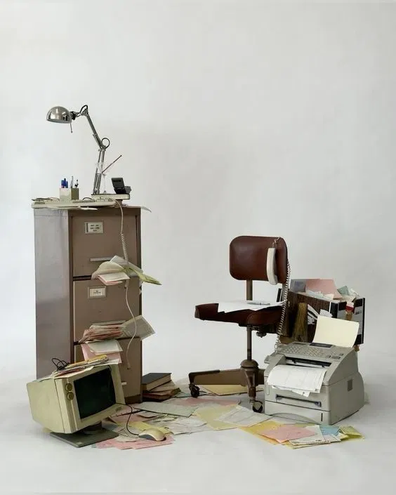
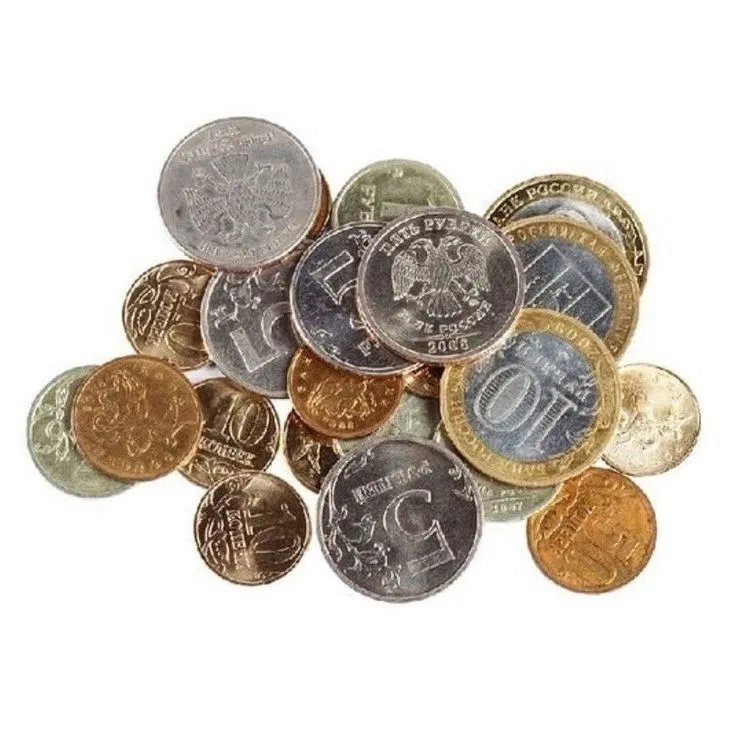
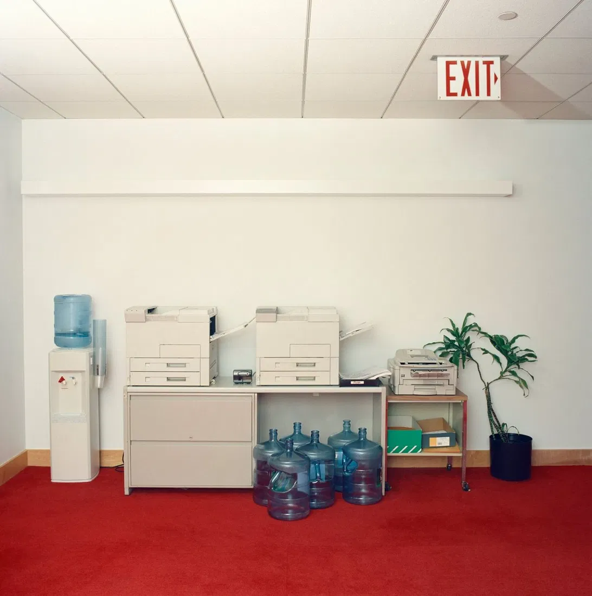
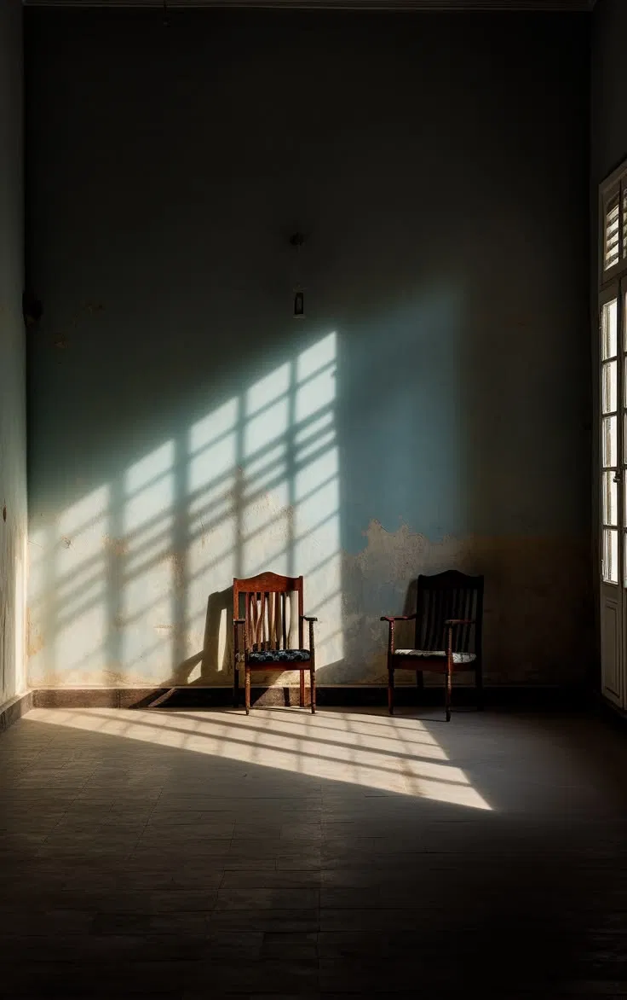

# Digital Image Processing

A small collection of Python scripts for exploring digital image processing. Each `q*.py` file is a self-contained demo: run it, and it will show you the image transformations or results in a plot. No fancy setup or deep background needed—just a curious eye.

## Getting started

You’ll need Python and a few common image/science libraries. From the repository folder, install them with:

```bash
python -m pip install numpy opencv-python matplotlib
```

Then run any example, for instance:

```bash
python q3.py
```

The scripts expect to be run from this folder so they can find the sample images. Most open a plot window; close it to finish the run. Some examples also print a couple of comparison numbers in the terminal.

## What’s in here?

| Script | What it explores |
| --- | --- |
| `q3.py` | Image negatives, log transforms, and brightness changes |
| `q5.py` | Contrast stretching and histogram equalization |
| `q7.py` | Sharpening and finding edges with Laplacian, Sobel, and Prewitt filters |
| `q10.py` | Motion blur and image restoration with inverse and Wiener filters |
| `q11.py` | The 2D Fourier transform and rebuilding an image from it |
| `q12.py` | Gaussian and Butterworth low-pass filtering |
| `q13.py` | High-pass filtering and sharpening |
| `q15.py` | Homomorphic filtering for uneven lighting |
| `q16.py` | Global, iterative, and Otsu image thresholding |
| `q18.py` | Finding straight lines in an image |
| `q19.py` | Separating touching objects with watershed segmentation |

`helper.py` contains a few shared helpers for loading images, applying filters, and displaying results.

## Sample images

These are the images the scripts use as starting points. Click any image to open the full-size file.

| `general.png` | `coins.png` |
| --- | --- |
| [](general.png) | [](coins.png) |
| Used by several filtering and enhancement demos. | Used for thresholding and separating objects. |

| `lines.png` | `uneven.png` |
| --- | --- |
| [](lines.png) | [](uneven.png) |
| Used by the line-detection demo. | Used by the uneven-lighting demo. |

## A couple of handy notes

- Want to try your own image? Replace the filename passed to `load_gray(...)` or `load_color(...)` in the relevant script, and keep the image in this folder (or pass a path to it).
- If a script says it can’t read an image, double-check that you launched it from the repository folder and that the filename matches.
- These are learning examples, so feel free to tweak the parameters and see what changes.
